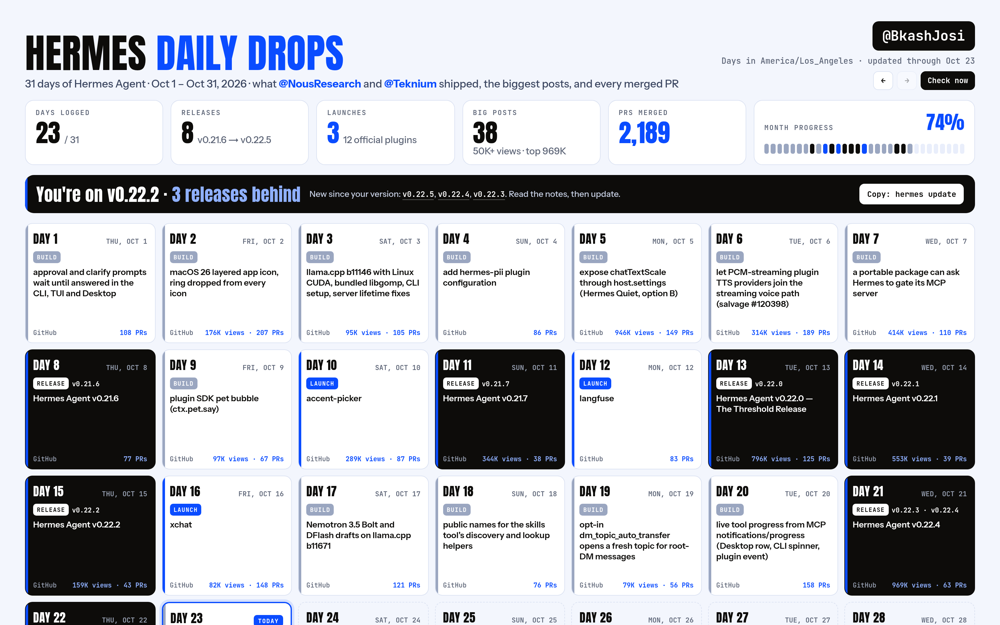
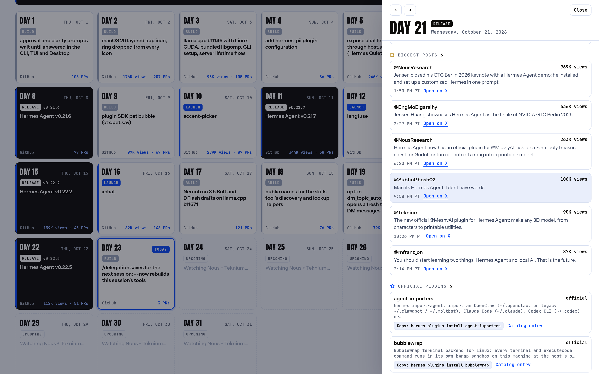
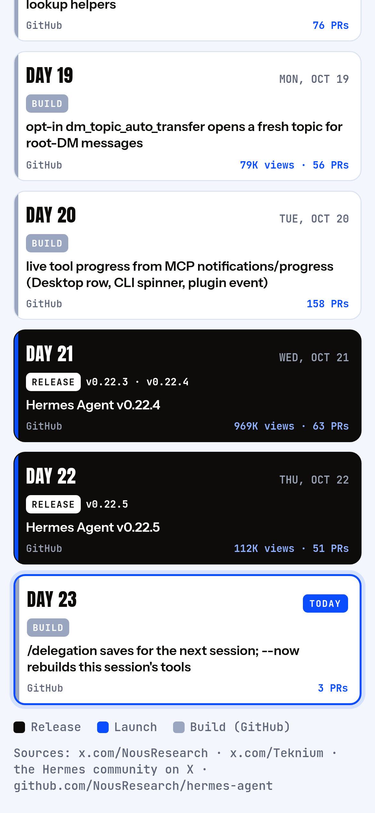

# Nous Calendar for Hermes Agent

**Never miss a Nous drop.** A month calendar of what Nous Research shipped for Hermes Agent, day by day, inside Hermes Desktop.



| Tap a day: what shipped, and the day's biggest posts | On your phone |
|---|---|
|  |  |

*Real screenshots of the plugin with October 2026 data. Live on the web: **https://nous-calendar.vercel.app***

Nous merges 50–200 pull requests a day. Most are fixes. The calendar shows the drops a Hermes user cares about and folds the rest into a count:

| Badge | What it is | Where it comes from |
|---|---|---|
| **Release** | A Hermes Agent release | `NousResearch/hermes-agent` releases |
| **Official plugin** | A new official plugin in the catalog | `plugin-catalog/` entries with `tier: official` |
| **Feature** | A merged feature PR (`feat(…)`) | `NousResearch/hermes-agent` pull requests |
| **Update** | A new feature in an official plugin | `NousResearch/hermes-official-plugins` commits |
| **Catalog** | A plugin new in the plugin catalog | `plugin-catalog/` compared day by day |
| *N merged PRs* | Every merged PR that day, counted, never listed | `NousResearch/hermes-agent` |

Release days are drawn in ink, launch days get a blue date, and a thin bar along each day's bottom edge shows how many PRs merged. Click a day to open its sheet, with every drop and its link. Days follow your own time zone.

## Install

```bash
hermes plugins install BkashJEE/hermes-nous-calendar --enable
```

Then restart Hermes Desktop (or Capabilities → Plugins → Rescan). **Nous Calendar** appears in the sidebar and in ⌘K.

For exact catalog data and the merged-PR counts, sign in to GitHub once on the same machine:

```bash
gh auth login
```

Without it the calendar still works on GitHub's anonymous limit (60 requests an hour): catalog additions are read from commit messages and the merged-PR counts are left out.

## It keeps itself current

You don't have to open anything for it to stay up to date.

- **Every 6 hours** the plugin's backend re-reads the current month from GitHub, while Hermes is running.
- **Every 30 minutes** Hermes Desktop picks up what the backend found.
- **A desktop notification** fires for each new release and each new official plugin. It never fires on the first launch.
- **The status-bar chip** (☤) counts releases, official plugins and features since you last opened the page.
- **"You're N releases behind"**: the page compares your installed Hermes with the newest stable release, lists what you missed and copies `hermes update` for you.

Links open in Hermes Desktop's own browser pane, like links in chat (Ctrl/⌘-click for your system browser). Every new plugin in a day's sheet has a copy-the-install-command button.

## Ask Hermes

The plugin adds a `nous_calendar` tool and a `nous-calendar` skill, so any chat can answer:

> What did Nous ship this week?
> Has a new release landed today?
> Which official plugins came out in October?

Want it in Telegram or Discord every morning? Ask Hermes to set up a daily Nous Calendar message. It will confirm the time and channel before it creates the cron job.

## From the terminal

```bash
hermes nous-calendar --week          # the last 7 days
hermes nous-calendar --today
hermes nous-calendar --month 2026-10
/nous-calendar                        # the same, in any Hermes chat
```

## The biggest posts, from X

Each day also lists **the biggest posts about Hermes on X** (50K+ views) and **posts by the Nous team**, with their view counts and links. The day's corner shows the top post's views. They come from a small public feed, `https://nous-calendar.vercel.app/posts.json`, picked each morning from public posts by @NousResearch, @Teknium and the Hermes community. The plugin reads it once every 15 minutes at most; set `NOUS_CALENDAR_POSTS=off` to turn it off. It never sends anything.

If you keep your own curated file in the same shape, the plugin uses it instead: `NOUS_CALENDAR_X_FILE=/path/to/file.json` or `~/.hermes/plugin-data/hermes-nous-calendar/x-drops.json`.

## What it reads and stores

- **Reads:** public GitHub data, through your signed-in `gh` if there is one, else `GITHUB_TOKEN`/`GH_TOKEN`, else anonymously; and the public posts feed (`NOUS_CALENDAR_POSTS=off` to skip it).
- **Model calls:** none. The tool only returns data; your own model writes the answer when you ask in chat.
- **Stores:** one cache file (GitHub data only; the On-X file is re-read, never copied), `~/.hermes/plugin-data/hermes-nous-calendar/cache.json`. Finished months are kept; the current month is re-read at most every 15 minutes, plus the 6-hour background read.
- **Runs in the background:** one thread in the plugin's backend, which wakes every 30 minutes and reads GitHub at most every 6 hours.
- **Sends:** nothing anywhere. Two kinds of GET (GitHub, the posts feed); notifications are local desktop notifications.

## Limits

- "Feature" means a PR titled `feat(…)`. A feature that Nous merged under another title isn't badged; it's still in that day's merged count.
- A merged feature is on `main`. It isn't in a release until a release says so.
- Days are local: a late-evening release in your time zone may be the next day on GitHub.

## On the web (phones too)

Live: **https://nous-calendar.vercel.app**


`web/` builds the same page as a static site: GitHub data plus the public posts (no version check):

```bash
python3 web/build.py --months 3     # writes web/dist/
```

`.github/workflows/web.yml` rebuilds it every morning and deploys `web/dist` to Vercel once the repo has `VERCEL_TOKEN`, `VERCEL_ORG_ID` and `VERCEL_PROJECT_ID` secrets. On the web the page shows a "Get it inside Hermes Desktop" bar with the install command.

## Development

```bash
python3 tests/test_nous_calendar.py                          # unit tests (no network)
~/.hermes/hermes-agent/venv/bin/python tests/test_nous_calendar.py   # + backend tests
python3 harness/serve.py                                     # the page with real data on :4734
hermes plugins validate .
```

## License

MIT © Bikash Joshi. Fonts (Anton, Instrument Sans, JetBrains Mono; embedded in `desktop/plugin.js`, sources in `desktop/fonts`) are under the SIL Open Font License 1.1; see `desktop/fonts/OFL.txt`. Built on [Hermes Agent](https://github.com/NousResearch/hermes-agent) by Nous Research. Not affiliated with Nous Research.
